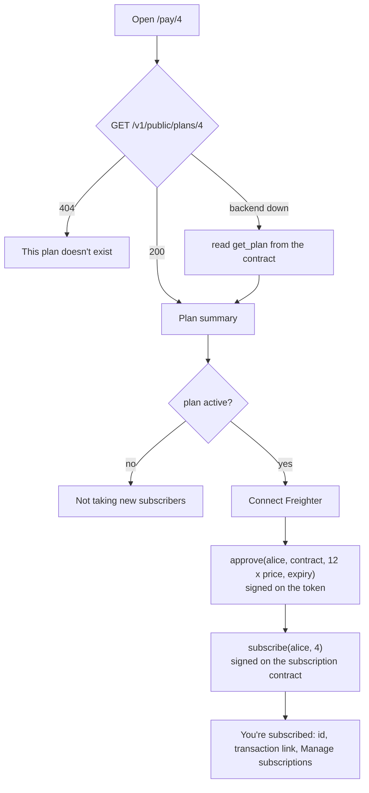

# lumensub-app

The screens people actually touch in [LumenSub](https://github.com/lumensub): a dashboard where a
merchant creates plans and watches revenue, a checkout page that signs someone up from
their own Stellar wallet, and a portal where subscribers pause, switch or cancel. It also
holds `@lumensub/sdk`, the TypeScript library those screens use to talk to the contract,
which you can use without the app.

Nothing here touches a private key. Every action that moves money or changes a
subscription is a contract call that the user signs in Freighter. The app only builds the
transaction and shows what happened.

## The screens

**`/`** explains the idea in three steps to someone who has never heard of it: the merchant
creates a plan, the subscriber approves once, payments run on schedule.

**`/merchant`** asks for an API key from [lumensub-backend](https://github.com/lumensub/lumensub-backend)
the first time, keeps it in this browser's local storage, and sends it only to the
configured API. Behind it are five tabs:

- **Overview:** MRR per token, live subscriptions and 30-day churn, a daily revenue chart and revenue per plan.
- **Plans:** your plans with a copyable checkout link each, and a form to create a new one.
- **Subscribers:** every subscription to your plans, filterable by status.
- **Webhooks:** add an endpoint and see its signing secret once.
- **API keys:** create and revoke keys.

**`/pay/<planId>`** is the hosted checkout. It shows the price, period, trial and merchant,
then walks through three steps: connect wallet, approve payments, confirm.

**`/account`** lists every subscription the connected wallet holds, with its status, payments
so far and next charge date. Each card offers only the actions the contract would accept in
that status, and expands into receipts.

**`/docs`** is a short integration guide: the checkout link, a copy-paste "Subscribe with
Stellar" button that is plain HTML with no script, the SDK, and how to verify webhooks.

## One subscription, screen by screen

Maya sells a 10 USDC monthly plan with a 7-day trial and a 3-day grace period. Alice signs
up on 1 March.

**Maya, creating the plan.** On the Plans tab she names it "Studio monthly", picks "Other
token" and pastes the USDC contract address (only XLM is listed by default), and enters 10,
monthly, 7 trial days, 3 grace days. The form rejects a trial over 365 days or grace over 30,
the same limits as the contract. Her first plan takes two Freighter signatures, one to
register her wallet as a merchant and one for the plan; after that it's one. The plan gets id
4 from the contract, and the name goes to the backend.

**Alice, at `/pay/4`.** She sees the 10 USDC price, the monthly period and the 7-day trial.
"Connect wallet" opens Freighter. The approve step says the subscription contract may take
up to 120 USDC across 12 payments, because open-ended plans approve a year of payments and
never an unlimited amount. She signs, then signs "Confirm subscription", and
gets "You're subscribed" with her subscription number and a link to the transaction.

**Day 0 to 7.** Maya's Subscribers tab shows Alice as Trial. Her MRR doesn't change yet; it
counts paid-up and past-due subscriptions only. Alice's `/account` card says "0 payments so
far, next on 8 Mar" and offers Pause, Change plan and Cancel.

**Day 7.** A keeper charges her. Maya's MRR goes to 10 USDC, the revenue chart gets its first
point, and 9.85 lands in her wallet (1% goes to the protocol treasury and 0.5% to the
keeper, the deploy defaults). Alice's receipts show "Paid, Cycle 1" with a link to the
transaction.

**Day 67.** Alice is short. Her card turns Past due and offers only Cancel, since the
contract won't let a past-due subscription pause or change plan. Her receipts show "Failed,
Balance too low". If she tops up within three days, the next retry succeeds and the card is
Active again. If not, it ends as Lapsed with no actions left.

One honest caveat: until the backend has token symbols, the screens show a pasted token's
amounts next to a shortened contract id rather than "USDC". That's on the roadmap below.



## Design decisions

**The contract decides, the backend decorates.** Prices, terms and statuses come from the
chain; the backend adds names, history and charts. That's why checkout falls back to reading
the plan straight from the contract when the API is unreachable
([`loadPlan.ts`](src/components/checkout/loadPlan.ts)). A customer can subscribe while our
server is down.

**Bounded approvals.** Fixed-length plans approve exactly what they will ever charge. Open-ended
plans approve twelve payments ([`approval.ts`](src/components/checkout/approval.ts)), and the
approval expires: we ask for enough ledgers to cover those payments, capped at about 3.1
million (roughly six months at five seconds a ledger), just under the network's maximum.
For a monthly plan the cap is what bites, so subscribers approve again around month six.

**Amounts stay `bigint` until the last moment.** From the contract's `i128` to the backend's
strings to the screen, token amounts are integers in base units and get formatted only when
rendered. Nobody's 9.85 becomes 9.849999.

**Next.js and the SDK in one repo.** The SDK is in `sdk/` and the app imports it through a path
alias, so a contract change lands as one pull request that updates the encoding, the types
and the screens together. Splitting them would mean publishing a package to test a button.
When the interface settles we'll publish `@lumensub/sdk` to npm from this folder.

**Contract errors read like sentences.** The SDK maps all twenty contract error codes to
messages a subscriber can act on ([`sdk/src/errors.ts`](sdk/src/errors.ts)), so "Error(Contract,
#17)" reaches the screen as "The approved amount is too low. Approve more and try again."

## Things we chose not to do, or haven't yet

- No custodial checkout, card payments or email signups. A wallet is the account.
- No allowance renewal in the portal yet. Subscribers re-approve with any wallet; the portal
  should do it for them, and doesn't.
- The portal needs the backend to list subscriptions. Checkout and every action work against
  the contract directly, but finding "my subscriptions" without an indexer means scanning,
  which we haven't built.
- No screenshots in this README yet. We'd rather add real ones from a testnet deployment than
  mock-ups.

## Questions we get

**Can the app take more than the plan price?** The app can't take anything; it can only ask
your wallet to sign. The contract charges at most the plan price once per period, and the
token won't let it exceed the allowance you approved, which the approve step shows in full
before you sign.

**What if your backend goes down?** Checkout still works, falling back to the contract. The
dashboard and portal show a warning instead of data. Billing itself doesn't depend on any of
this; see [lumensub-contracts](https://github.com/lumensub/lumensub-contracts).

**Can I cancel without the app?** Yes. Cancel is one contract call you can make from the
Stellar CLI or any other client; the contracts README has the exact command.

**What happens to my allowance after I cancel?** It stays on the token until it expires. The
contract never charges a cancelled subscription. To clear it now, approve 0 for the
subscription contract from your wallet.

## Running it

Node 20 or newer, and the [Freighter](https://www.freighter.app/) extension set to the same network.

```sh
npm ci
cp .env.example .env.local
npm run dev        # http://localhost:3000
```

The app starts with an empty `.env.local` and shows empty states. To use it for real, set:

| Variable | |
| --- | --- |
| `NEXT_PUBLIC_STELLAR_NETWORK` | `testnet` (default), `mainnet` or `futurenet` |
| `NEXT_PUBLIC_SOROBAN_RPC_URL` | optional on testnet, required on mainnet |
| `NEXT_PUBLIC_SUBSCRIPTION_CONTRACT_ID` | the `SUBSCRIPTION_CONTRACT_ID` from lumensub-contracts' `.env.testnet` |
| `NEXT_PUBLIC_API_URL` | lumensub-backend, `http://localhost:8080` by default |

The backend only answers browsers from the origins in its `CORS_ORIGINS`, which defaults to
`http://localhost:3000`, so a local setup works as is.

`npm run lint`, `npm run typecheck`, `npm test` (64 tests) and `npm run build` are what CI runs.
More detail: [architecture](docs/architecture.md), [SDK reference](docs/sdk.md),
[checkout integration](docs/checkout-integration.md).

## Status

Testnet only, unaudited, and changing. Please don't point it at mainnet with real money.

The same checklist appears in all three repos:

- [x] Subscription contract: trials, grace periods, pause and resume, plan changes with credit, refunds
- [x] Revenue splitter
- [x] Backend: indexer, keeper, merchant API, signed webhooks
- [x] App: merchant dashboard, hosted checkout, subscriber portal, `@lumensub/sdk`
- [ ] A shared testnet deployment with a published contract id
- [ ] Token symbols and decimals in the backend, so the app can stop showing contract ids
- [ ] `@lumensub/sdk` published to npm
- [ ] An external audit of the contracts, before anything touches mainnet

Issues and pull requests are welcome; [CONTRIBUTING.md](CONTRIBUTING.md) covers setup and
conventions, and security problems go to [SECURITY.md](SECURITY.md). MIT licensed.
